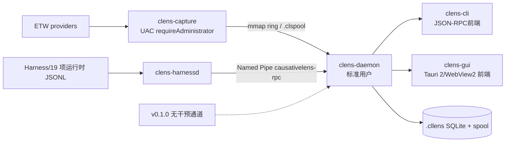

# CausativeLens v0.1.0 发布列车实施方案

Language navigation: [English plan index](README.en-US.md) · [简体中文计划](README_CN.md) · [繁體中文计划](README_TW.md)。

语言导航：[English docs](../README.md) · [简体中文](../README_CN.md) · [繁體中文](../README_TW.md)。

## 范围与命名

版本一次性交付原蓝图 M0–M7，内部闸门为 G0–G7。v0.1.0 只有 `observe`：CLI 不注册 `advise`、`enforce`、决策族命令；SQLite 保留 `interventions`、`decisions` 建表迁移但没有写入路径。蓝图第12.4、19、21章作为 v0.2.0 输入，不实现。

全局映射：产品 `CausativeLens`，仓库 `causativelens`，用户可见字符串、注册表、`%LOCALAPPDATA%\causativelens`、Named Pipe `\.\pipe\causativelens-rpc`、ETW 前缀 `CausativeLens_`；crate 前缀 `clens-*` 保留；`.cllens`、`.clspool`、`CL-BLUEPRINT-001` 保留。

## G0–G7 闸门

| 闸门 | 周期 | 出口判据（可测） | 改动范围 | 蓝图依据 |
|---|---:|---|---|---|
| G0 | 1周 | `cargo fmt --check; cargo clippy --workspace --all-targets -- -D warnings; cargo test --workspace` 全绿；两架构空包安装、卸载、版本显示正确 | workspace、版本契约、Tauri/NSIS 骨架、CI | 第5、15、16章；表18 M0 |
| G1 | 4周 | 四 ETW provider 会话；手工解码+TDH兜底；rundown；`.clspool` 可恢复；丢失/背压指标；x64/ARM64 CI | `clens-capture`、types、spool、fixtures | 第3、7、10、13章；表18 M1 |
| G2 | 3周 | 18 个目标 Harness 适配器 tail JSONL；规则层断言编译；daemon JSON-RPC；断言 fixture 全绿 | `clens-harnessd`、daemon、protocol、runtime adapters | 第8、12章；表18 M2 |
| G3 | 4周 | 三元对齐+64ms水位线；12剧本结果一致；graph.sqlite 索引与回放可重建 | `clens-core`、storage、bench | 第6、9、10、13章；表18 M3 |
| G4 | 3周 | `run/attach/open/why/timeline/watch/export/doctor/shell` observe 子集稳定；JSON/人类输出；版本与错误码兼容 | `clens-cli`、query、daemon RPC | 第11、12、14章；表18 M4 |
| G5 | 3周 | daemon 常驻接线；Named Pipe；19 项运行时真实文件/进程 tail、doctor、schema 哨兵；observe 会话闭环 | `clens-daemon`、`clens-harnessd`、capture/core/storage 接线 | 第4、8、11、13章；表18 M5 |
| G6 | 2周 | Tauri 2 四工作区；GUI 仅调用 daemon；冷启动<600ms、RSS<150MB、10万事件≥45fps、`graph.delta`<8ms/批 | `clens-gui`、daemon、UX | 第4.3、11.4、13.1；表24 |
| G7 | 2周 | `CausativeLens-setup-x64.exe`/`-arm64.exe` 安装、升级、静默、回滚、卸载 E2E；20真实会话；包<25MB；签名/SBOM/Release 两 exe | installer、bundler、CI、release gate | 第14–17章、15章、20.5；表18 M7 |

## 顶层架构

这是“一 daemon 两前端”：GUI 不链接 `clens-core`/`clens-storage`，CLI 与 GUI 只调用同一 JSON-RPC。`clens-capture` 是唯一 UAC 提权进程；不装服务、不加载驱动、不注入。
跨平台 transport 通过 `clens-daemon-client` 共享；Windows 使用 Named Pipe，Unix 使用 `CAUSATIVELENS_RPC_SOCKET`。`clens-capture` 的 ETW/UAC 运行态仍需 Windows 实测，不能由静态依赖图替代。

## crate 依赖细化

| crate | 允许依赖 | 职责 | 禁止依赖 |
|---|---|---|---|
| `clens-types` | serde、uuid | IR、RPC schema、错误码 | Windows API、SQLite、Tauri |
| `clens-capture` | types、windows、bytemuck、clspool | ETW、解码、rundown、spool | GUI、SQLite、daemon业务逻辑 |
| `clens-harnessd` | types、serde_json、五适配器 | JSONL tail、断言提取 | Tauri、SQLite直写 |
| `clens-core` | types、crossbeam、hashmap | 对齐、履约图 | Tauri、Win32、RPC transport |
| `clens-storage` | types、rusqlite、zstd | SQLite、列式 spool、迁移 | GUI、capture控制 |
| `clens-daemon` | types、capture、core、storage、harnessd、transport | 生命周期、RPC、权限边界、Unix/Named Pipe server | Tauri UI、CLI渲染 |
| `clens-daemon-client` | types、serde_json、transport std | CLI/GUI 共享 JSON-RPC client；Windows Named Pipe 与 Unix socket | core、storage、capture、Tauri UI |
| `clens-cli` | types、daemon-client | 命令解析/渲染与 observe RPC 前端 | core/storage/daemon实现直接调用 |
| `clens-gui` | Tauri 2、daemon-client、前端资源 | 四工作区、Canvas、无业务引擎 | `clens-core`、`clens-storage`、capture API |
| `clens-installer` | Tauri bundler/NSIS脚本、签名工具 | 安装、卸载、注册表、WebView2引导 | 运行时 engine、daemon代码 |

## 打包前置策略

G0 创建 NSIS via Tauri bundler 的双架构骨架，空包也能安装/卸载；G1–G5 每次 CI 产出可安装包并跑烟测。Release 只上传两个 exe；zip 仅 CI artifact。安装器内含 `clens.exe`、`clens-gui.exe`、`clens-daemon.exe`、`clens-capture.exe`、卸载器与 SBOM。

## ADR 决策

### ADR-001 安装器选型
背景：需 per-user、自定义路径、PATH/注册表/关联、重启提示、卸载、静默、x64/ARM64。决策：Tauri bundler 调用 NSIS，同一脚本由 x64/ARM64 目标交叉构建。Inno Setup 否决：与 Tauri 资源生命周期和双架构流水线整合成本高；WiX 否决：MSI per-user/自定义路径和 WebView2 引导复杂，包体与维护成本更高。

### ADR-002 PATH 注入
背景：CLI 可从任意终端使用。决策：仅写用户级 `HKCU\Environment\Path`，按规范化大小写和最终反斜杠去重，广播 `WM_SETTINGCHANGE`；不写机器 PATH。备选：机器级 PATH，否决因需管理员且违反 per-user。

### ADR-003 注册表
决策：卸载 `HKCU\Software\Microsoft\Windows\CurrentVersion\Uninstall\CausativeLens`；App Paths `clens.exe`、`clens-gui.exe`；Classes `HKCU\Software\Classes\.cllens` 与 `CausativeLens.Session`；Environment 使用用户 Path。所有键写入前记录回滚清单。

### ADR-004 重启策略
决策：安装完成页显示“立即重启/稍后”，解释 PATH、注册表、WebView2 注册生效原因；不强制重启，安装器退出码区分需重启。shell 新进程验证广播已生效。

### ADR-005 签名
决策：Azure Trusted Signing 优先，CI 使用短期OIDC凭据；无服务凭据时阻断 Release，仅允许内部包。对 exe、安装器、卸载器签名，生成 SPDX SBOM 与 SHA-256。

### ADR-006 WebView2
决策：优先检测 Evergreen Runtime；缺失时完成安装引导并提供离线 bootstrapper 选项，GUI 首次启动给可执行错误。禁止把浏览器内核静态塞入包内。

### ADR-007 长路径与 Unicode
决策：安装器和 Rust API 全程 UTF-16/Unicode，路径使用长路径前缀或 `"\?\"`，启用 manifest `longPathAware`；E2E 覆盖中文、空格、OneDrive、>260字符路径。

### ADR-008 GUI 进程模型
决策：Tauri GUI 为短前端进程，daemon 独立生命周期；GUI 崩溃不丢采集，重连通过 session state。所有数据经 Named Pipe JSON-RPC；架构测试扫描依赖图阻断 engine 直连。

### ADR-009 命名映射
决策：用户可见面全部 `CausativeLens`/`causativelens`，内部 `clens-*` 保留，避免 ABI、路径和 crate 迁移风险。彻底改名前缀列入 v0.2.0 open question。

### ADR-010 干预层延后
决策：保留 schema、迁移和未知命令错误码，v0.1.0 不产生写入；客户端将 `intervention_unavailable` 渲染为“v0.2.0 计划功能”。这样保持前向兼容且不暗示 observe 有副作用。

## 指标与测量

包体用 `Get-Item *.exe` 汇总压缩后大小，目标<25MB；GUI 冷启动从创建进程到首个 `ui.ready` monotonic timestamp，目标<600ms；10万事件用固定 fixture 在 Canvas 滚动/缩放采样 PresentMon 帧时间，≥45fps；每批 `graph.delta` 记录 RPC 接收至绘制完成，p95<8ms；RSS 用 `Get-Process clens-gui` 峰值，<150MB。所有结果上传 CI artifact。

## ADR-011 三语用户界面与文档

背景：Windows 工具同时服务中文与英文开发者，且 JSON/RPC 需要长期稳定。决策：v0.1.0 支持 `en-US`、`zh-CN`、`zh-TW`；CLI 用 `--lang`/`CAUSATIVELENS_LANG`，GUI 使用内置字典并记住选择，NSIS 使用三语 `LangString`。协议字段、命令名、路径、注册表键和错误码保持英文，不随界面翻译。备选：按系统语言硬编码，否决因远程会话和脚本难以复现；引入运行时翻译服务，否决因离线、隐私和可重复性要求。

## 文档交付口径

根目录只保留 `README.md`（English）、`README_CN.md`（简体中文）和 `README_TW.md`（繁體中文）；详细指南、规格、计划、任务卡、发布记录和参考资料按 `docs/` 分类。每个入口提供三语切换，程序员的浪漫只出现在解释与导览文字，不进入机器契约。

